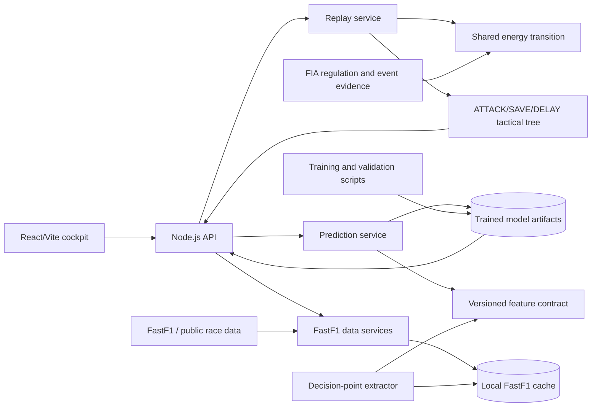

# PitWolf

## Explainable Energy and Overtake Strategy for Formula 1

PitWolf is a retrospective F1 strategy engine that estimates whether a driver should `ATTACK`, `SAVE`, or `DELAY` during a battle.

It combines public race telemetry, overtake modelling, tyre and pace context, modelled energy state, opponent response, and a deterministic tactical replay tree.

PitWolf does not claim access to private team battery telemetry or prove that an alternative race result would have happened. Its output is a modelled counterfactual estimate:

> Given the information available at a real race moment, which tactical action is estimated to preserve or gain a position for longer?

## Engineering problem

Modern overtaking is not only a question of speed.

A driver may have:

- A small gap to the car ahead.
- A speed or tyre advantage.
- A limited energy reserve.
- A better overtaking zone approaching.
- An opponent with enough energy to defend or attempt a repass.
- A pit stop, flag, safety-car, or traffic event that changes the situation.

A simple rule such as “attack when the gap is below one second” ignores the long-term cost of the decision.

The engineering challenge is to model the short-term opportunity and the longer-term consequence together:

```text
Should the driver spend energy now,
preserve it for a better opportunity,
or delay the attempt until the state improves?
```

## Solution

PitWolf has three main layers.

### 1. Historical decision modelling

PitWolf extracts close-battle decision points from completed races using FastF1 data.

Features include:

- Gap and closing rate.
- Relative speed and lap pace.
- Tyre compound, age, and degradation proxies.
- Track position and lap fraction.
- Traffic, pack density, slipstream, and dirty-air proxies.
- DRS or overtake eligibility where available.
- Race-control and pit-cycle context.
- Modelled energy state for both drivers.

Historical races from 2018–2025 are used for training and development. Completed 2026 races are held out for final evaluation.

The extracted labels describe outcome patterns. They are not claims about what the driver was actually instructed to do.

### 2. Modelled energy state

Public FastF1 data does not expose a team’s private battery state, ERS button presses, deployment map, or strategic instructions.

PitWolf therefore labels energy values as `MODELLED`.

The energy layer estimates deployment and recovery using public telemetry and regulation-aware constraints. It tracks both cars so that:

- The attacker can spend energy to attempt a pass.
- The defender can spend energy to prevent the pass.
- The former defender can attempt a repass after losing position.
- Energy is carried forward instead of being reset after a pit stop.

The result is a physically and regulatorily constrained surrogate, not measured team battery telemetry.

### 3. Tactical replay

At a selected historical decision point, PitWolf evaluates:

```text
ATTACK
SAVE
DELAY
```

The tactical tree:

1. Starts from the observed race state.
2. Evaluates all three actions.
3. Applies the shared energy transition.
4. Models a deterministic conservative opponent response.
5. Reverses attacker and defender roles after a pass.
6. Projects position durability over a bounded horizon.
7. Compares the estimated result with the observed race.

The primary tactical objective is expected laps ahead. Final finishing position is reported separately because the current replay models a selected battle pair rather than the entire field.

## Architecture



### Main components

```text
frontend/
  React/Vite strategy cockpit

backend/server.mjs
  Node.js API and process orchestration

backend/scripts/
  FastF1 extraction
  feature generation
  model training
  energy modelling
  tactical replay
  validation and audit tools

backend/data/
  source-controlled static evidence and rule context

backend/data/f1-cache/
  local generated race data, models, reports, and replay artifacts
```

The FastF1 cache is intentionally ignored by Git because it is large, machine-generated, and reproducible.

## Installation

### Requirements

- Git
- Node.js 20 or later
- Python 3.13
- Internet access for FastF1 downloads
- Approximately 30 GB of free disk space for a full local rebuild

### Install JavaScript dependencies

From the repository root:

```powershell
npm ci
```

### Create the Python environment

```powershell
py -3.13 -m venv backend\.venv
backend\.venv\Scripts\Activate.ps1

python -m pip install --upgrade pip
python -m pip install -r backend\requirements-data.txt
```

Verify the environment:

```powershell
Get-Command python
python -c "import fastf1, pandas, numpy, sklearn, duckdb; print('Data environment OK')"
```

The active Python should resolve to:

```text
backend\.venv\Scripts\python.exe
```

## Run the application

Start the backend in one terminal:

```powershell
backend\.venv\Scripts\Activate.ps1
npm run server
```

Start the frontend in a second terminal:

```powershell
npm run dev -- --host 127.0.0.1
```

Open:

```text
http://127.0.0.1:5173/
```

Check the backend:

```powershell
Invoke-WebRequest -UseBasicParsing http://127.0.0.1:8787/api/health
```

## Working demonstration

The application can replay recorded public race data before the full historical model is built.

For a model-backed demonstration, create the local decision-point dataset and train the model:

```powershell
backend\.venv\Scripts\python.exe backend\scripts\batch_extract_decision_points.py `
  --start-year 2018 `
  --end-year 2025 `
  --session R `
  --hold-laps 6
```

Then train the model:

```powershell
backend\.venv\Scripts\python.exe backend\scripts\train_overtake_model.py `
  --test-from 2026 `
  --n-jobs 1
```

The expected local artifacts are:

```text
backend/data/f1-cache/models/overtake_rf.joblib
backend/data/f1-cache/models/overtake_report.json
```

### Demonstration flow

1. Open the PitWolf cockpit.
2. Select a completed 2026 race.
3. Select a driver and a recorded lap.
4. Inspect the real race state:
   - position;
   - gap;
   - pace;
   - tyre context;
   - telemetry;
   - race-control state.
5. Select `JUMP / BRANCH LAP`.
6. Start the PitWolf branch.
7. Compare `ATTACK`, `SAVE`, and `DELAY`.
8. Inspect both cars’ modelled energy state.
9. Review the opponent response and estimated position durability.
10. Compare the branch with the observed race and validation baselines.

The replay is a modelled selected-pair analysis. It is not a rewritten official classification.

## Experimental results

The current v6 evaluation is a research benchmark using historical training data and completed 2026 holdout races.

A current reported run gives the following results:

| Method | Accuracy | Macro F1 |
|---|---:|---:|
| Random Forest action policy | 70.85% | 48.20% |
| Logistic Regression | 56.68% | 41.17% |
| Gradient Boosted Trees | 60.26% | 44.81% |
| Always-SAVE baseline | 77.36% | 29.08% |

The Random Forest has better balanced performance than always-SAVE, especially because always-SAVE never identifies ATTACK or DELAY. However, always-SAVE still has higher raw accuracy because `SAVE` is the dominant class.

Therefore, the current model is a research candidate, not a validated live race-command policy.

Additional diagnostic results include:

- Immediate-pass modelling shows useful ranking signal but is observational, not causal.
- Pass-durability modelling has moderate discrimination at longer horizons but does not yet beat a historical constant-rate reference on probability error.
- The BOX baseline has an AUC of approximately 0.69, but only around 6% precision at the neutral threshold because pit entry is a rare event.
- Weather features were tested and excluded from the active model after reducing held-out performance.
- Probability calibration reduced calibration error but harmed action classification performance, so it remains a benchmark rather than the production candidate.

## Tests and validation

Basic software checks:

```powershell
npm run build
node --check backend/server.mjs
python -m py_compile backend\scripts\replay_strategy.py
```

The data and modelling pipeline also includes audits for:

- Future-feature leakage.
- Decision-point schema versions.
- Label eligibility.
- Participant rosters.
- Driver position summaries.
- Shared feature contracts.
- Energy transition behaviour.
- Cached race completeness.

Validation must be performed using race-grouped temporal splits. Rows from the same race should not be randomly divided between training and testing because adjacent laps are strongly correlated.

The final evaluation must keep the evaluated 2026 races outside model fitting and threshold selection.

## Limitations and failure cases

### Private battery state is unavailable

PitWolf cannot observe:

- Actual team state of charge.
- Exact ERS deployment commands.
- Team energy-management modes.
- Driver radio instructions.
- Fuel load and setup details.

All battery and deployment outputs are modelled estimates.

### The replay is currently pair-focused

The tactical replay models the selected driver and immediate opponent. It does not yet fully model:

- Every car in the field.
- Counterfactual traffic.
- Undercut and overcut outcomes.
- Tyre warm-up after a pit stop.
- Complete pit strategy.
- Retirements.
- Future safety-car or red-flag changes.

A projected pair result must not be described as a guaranteed alternate finishing position.

### Observed actions are not causal labels

A real pass proves that a pass happened under the real driver’s action and environment. It does not prove that ATTACK caused the result or that SAVE would have failed.

For this reason, immediate-pass and durability components are currently diagnostic and are not treated as causal action-effect models.

### FIA data is event-specific

Generic gap thresholds cannot represent every circuit’s 2026 Overtake Mode rules.

A race remains `ANALYSIS_ONLY` when exact cited detection lines, activation lines, recharge limits, power profiles, or race-control restrictions are unavailable.

PitWolf is:

> A public-data-based, explainable F1 strategy research engine that estimates the energy and position-durability consequences of ATTACK, SAVE, and DELAY decisions in historical race situations.

PitWolf is not yet:

- A live pit-wall command system.
- A source of private battery telemetry.
- A complete full-grid race simulator.
- Proof that a counterfactual result would have happened.
- A guaranteed optimal strategy planner.

## Roadmap

1. Improve minority-action precision and recall.
2. Complete broader unseen-race replay evaluation.
3. Improve same-time and same-track-distance alignment.
4. Add stronger causal pass and durability modelling.
5. Validate tyre, pit, traffic, and race-control transitions.
6. Expand from selected-pair replay to wider race-state modelling.
7. Keep exact FIA event data and command gating separate from generic analysis.
8. Consider real-time inference only after the retrospective system is reliable.

## Research status

PitWolf is an experimental research and engineering project. Results should be interpreted with the stated data, model, and replay assumptions.
